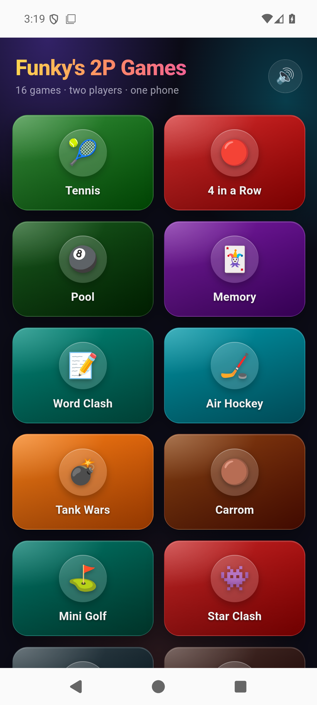

# 2P Games

**FR** — 16 jeux tactiles pour deux, sur un même téléphone : écran partagé en deux moitiés, ou chacun son tour. Les règles sont derrière un ? dans chaque jeu. Sans pub, sans compte, sans achat, sans connexion.

**EN** — 16 touch games for two, on one phone: the screen split in two halves, or turn by turn. Rules behind a ? in each game. No ads, no accounts, no purchases, no connection.

## Key points

- The games: Tennis, 4 in a Row, Pool, Memory, Word Clash, Air Hockey, Tank Wars, Carrom,
  Mini Golf, Star Clash, Caro, Awalé, Duck-Day Chess, Hangman, Reversi, Horse Jump.
- Two players on one phone. The app needs no connection and asks for no permission.
- A game ends on a button to play again, except Pool and Mini Golf: reopen them from the menu.
- Sounds are synthesised; there are no audio files. No tracking.

## Install


[](https://gallaz.ch/eink/#obtainium)

- **F-Droid** (recommended, updates arrive by themselves): add the repository from [gallaz.ch/eink](https://gallaz.ch/eink/#fdroid), or the address `https://funkypitt.github.io/fdroid-repo/repo` in F-Droid.
- **Obtainium**: tap the badge on the phone, or add `https://github.com/funkypitt/local-2p-games` in Obtainium.
- **APK**: attached to the [latest release](../../releases/latest). No automatic updates.

All three deliver the same file, with the same signature.

## Build

Capacitor (Android) wrapping a vanilla HTML/JS web app. All the game logic lives in `app.js`.

```
npm install
mkdir -p www && cp index.html app.js felix.png www/
npx cap sync android
cd android && ./gradlew assembleRelease
```

## Crédits / Credits

© 2026 Pierre Gallaz. Développé avec [Claude Code](https://claude.com/claude-code) (Anthropic).
Licence MIT, voir `LICENSE`.

© 2026 Pierre Gallaz. Developed with [Claude Code](https://claude.com/claude-code) (Anthropic).
MIT licence, see `LICENSE`.

## Captures d'écran

 
